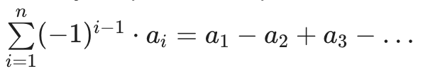

# Делёж грибов

## Условие

Вася и Маша ходили в лес и собрали *n* грибов, для каждого гриба известен его вес a<sub>i</sub>. Они выложили их в один ряд и решили делить следующим образом: первый гриб берёт Вася, второй −− Маша, третий −− Вася, четвёртый −− Маша и т.д.

Вася очень любит грибы и не очень любит Машу. Количество радости Васи равно разности суммарного веса грибов, доставшихся Васе, и суммарного веса грибов, доставшихся Маше. Т.е. радость вычисляется по формуле: 

Маша отвлеклась на минутку, и за это время Вася может выбрать любые два гриба и поменять их местами (а может и не менять). Определите максимальную радость Васи, которую можно достичь не более чем одним обменом.

## Формат ввода

В первой строке содержится одно натуральное число *n* −− количество грибов (2≤n≤10<sup>5</sup>).

Во второй строке содержится *n* чисел a<sub>i</sub> −− вес грибов (1≤a<sub>i</sub>≤1000).

## Формат вывода

Выведите максимальную радость Васи.

### Пример 1

Ввод

```
2
1 2
```

Вывод

```
1
```

### Пример 2

Ввод

```
3
2 2 2
```

Вывод

```
2
```

### Пример 3

Ввод

```
11
4 10 7 5 4 5 3 8 3 2 5
```

Вывод

```
10
```


| #    | Время                                                        | Память                                  |
| ---- | ------------------------------------------------------------ | --------------------------------------- |
| 1    | `O(n³)` - два вложенных цикла перебирают пары — `O(n²)`. Для каждой пары `hapinessCalculate` проходит весь слайс — `O(n)`. | `O(1)` - создается несколько переменных |
| 2    | `O(n)` - один проход                                         | `O(1)`                                  |
|      |                                                              |                                         |


## Решение 1. Brute-force search

Делаем полный перебор всех перестановок с расчетом для каждой из перестановок - радости Васи.

[Реализация](solution1.go):

```php
func division(a []int) int {
	// заполняем изначально максимальное значение счастья, когда не меняем местами элементы
	// установить в ноль нельзя, максимальное значение счастья может быть отрицательным
	maxHapiness := hapinessCalculate(a, -1, -1)

	// перебираем все пары элементов и меняем их местами, чтобы найти максимальное значение счастья
	for i := range len(a) {
		for j := i + 1; j < len(a); j++ {
			hapiness := hapinessCalculate(a, i, j)
			maxHapiness = max(maxHapiness, hapiness)
		}
	}

	return maxHapiness
}

func hapinessCalculate(a []int, i int, j int) int {
	var hapiness int
	for index, value := range a {
		// если индекс равен i или j, то меняем местами элементы
		switch index {
		case i:
			value = a[j]
		case j:
			value = a[i]
		}
		hapiness += sign(index) * value
	}

	return hapiness
}

func sign(i int) int {
	// возвращаем ПЛЮС, если индекс четный, и МИНУС, если индекс нечетный
	if i%2 == 0 {
		return 1
	}

	return -1
}

```


## Решение 2. Поиск минимального гриба Васи и максимального гриба Маши

Обмен грибов одного владельца не меняет радость. 

Максимальный выигрыш даёт обмен минимального гриба Васи на максимальный гриб Маши.  Находим минимальный гриб Васи и максимальный гриб Маши. 

Если Машин гриб больше, добавляем этот выигрыш к исходной радости. Если Вася отдаёт гриб веса `x`, а получает от Маши гриб веса `y`,  радость увеличивается на **`2 × y - 2 × x)`**.

Иначе ничего не меняем.

[Реализация](solution2.go):

```go
func division(a []int) int {
	// текущее значение радости Васи
	happiness := 0
	// минимальный гриб Васи
	minVasyaIdx := 0
	// максимальный гриб Маши
	maxMashaIdx := 1

	// проходимся по всем грибам
	// считаем (1) текущее значение радости
	// (2) минимальный гриб Васи (3) максимальный гриб Маши
	for i, val := range a {
		if i%2 == 0 {
			// это гриб Васи
			happiness += val
			if a[minVasyaIdx] > val {
				minVasyaIdx = i
			}
			continue
		}

		// это гриб Маши
		happiness -= val
		if a[maxMashaIdx] < val {
			maxMashaIdx = i
		}
	}

	// если грибов меньше 2, то поменять нечего (по условию, такого не должно быть)
	if len(a) < 2 {
		return happiness
	}

	// если минимальный гриб Васи - меньше максимального гриба Маши
	if a[minVasyaIdx] < a[maxMashaIdx] {
		// меняем их местами
		// итоговое счастье - исходное счастье плюс 2 * максимальный гриб Маши минус 2 * минимальный гриб Васи
		return happiness + 2*a[maxMashaIdx] - 2*a[minVasyaIdx]
	}

	return happiness
}

```


