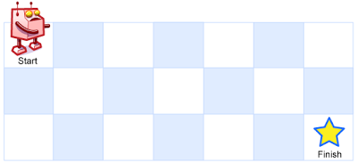
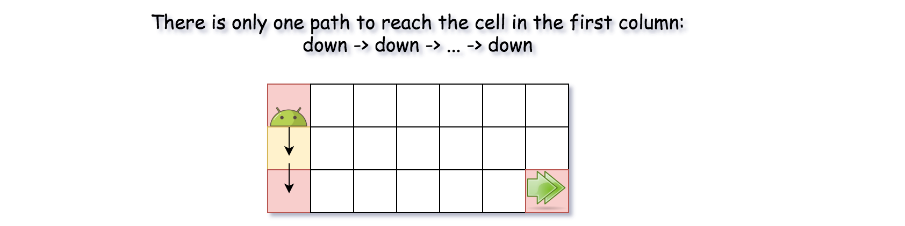
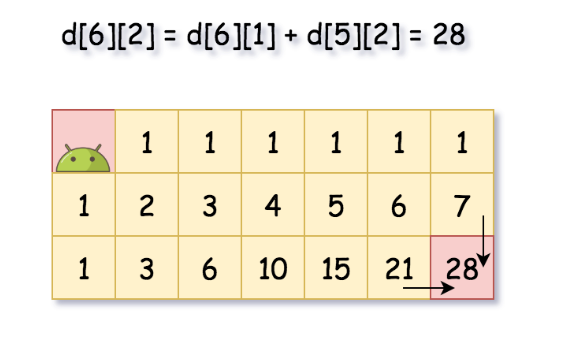

# 62. Unique Paths

## Condition

There is a robot on an `m x n` grid. The robot is initially located at the **top-left corner** (i.e., `grinumPaths[0][0]`). The robot tries to move to the **bottom-right corner** (i.e., `grinumPaths[m - 1][n - 1]`). The robot can only move either down or right at any point in time.

Given the two integers `m` and `n`, return *the number of possible unique paths that the robot can take to reach the bottom-right corner*.

The test cases are generated so that the answer will be less than or equal to 2 * 10<sup>9</sup>.

 

**Example 1:**



```
Input: m = 3, n = 7
Output: 28
```

**Example 2:**

```
Input: m = 3, n = 2
Output: 3
Explanation: From the top-left corner, there are a total of 3 ways to reach the bottom-right corner:
1. Right -> Down -> Down
2. Down -> Down -> Right
3. Down -> Right -> Down
```

 

**Constraints:**

- `1 <= m, n <= 100`

## Условие

На поле размером `m x n` находится робот. Изначально он расположен в **верхнем левом углу** (то есть в точке `grinumPaths[0][0]`). Робот пытается добраться до **нижнего правого угла** (то есть до точки `grinumPaths[m - 1][n - 1]`). В каждый момент времени робот может двигаться только вниз или вправо.  Для двух целых чисел `m` и `n` верните *количество возможных уникальных путей, по которым робот может добраться до нижнего правого угла*.  Тестовые примеры составлены таким образом, что ответ будет меньше или равен 2 * 10<sup>9</sup>.

**Пример 1:**


```
Input: m = 3, n = 7
Output: 28
```

**Пример 2:**

```
Input: m = 3, n = 2
Output: 3
Объяснение: из левого верхнего угла в правый нижний можно попасть тремя способами.
1. Right -> Down -> Down
2. Down -> Down -> Right
3. Down -> Right -> Down
```

 Есть два способа реализации:

- **Сверху вниз — рекурсия с мемоизацией:** перед вычислением проверяем, сохранён ли ответ; после вычисления сохраняем.
- **Снизу вверх — заполнение таблицы:** начинаем с простых случаев и постепенно вычисляем остальные.


| #    | Время    | Память   |
| ---- | -------- | -------- |
| 1    | `O(m*n)` | `O(m*n)` |
| 2    | `O(m*n)` | `O(m*n)` |
|      |          |          |


## Решение 1. Рекурсия с мемоизацией

Поскольку робот может двигаться как вниз, так и вправо, существует только один путь к ячейкам первого ряда: вправо -> вправо -> ... -> вправо.


То же самое справедливо и для первого столбца, хотя здесь путь выглядит так: вниз->вниз->...->вниз.



А что насчет «внутренних» ячеек `(m, n)`? В такую ячейку можно переместиться либо из ячейки слева `(m, n - 1)`, либо из ячейки сверху
`(m - 1, n)`. Это означает, что общее количество путей перемещения в `(m, n)` ячейку равно `uniquePaths(m - 1, n) + uniquePaths(m, n - 1)`.


В базовом варианте решение имеет экспоненциальную сложность. 

Добавим мемоизацию - перед вычислением проверяем, сохранён ли ответ для текущей клетки; после вычисления сохраняем.

```go
func uniquePaths(m int, n int) int {
	memo := make([][]int, m)
	for i := range m {
		memo[i] = make([]int, n)
	}
	return recursion(m-1, n-1, memo)
}

func recursion(i int, j int, memo [][]int) int {
	// проверяем - сохранено ли уже значение для клетки
	if memo[i][j] != 0 {
		return memo[i][j]
	}

	// для первой строки и первого столбца - только один способ попасть в них
	if i == 0 || j == 0 {
		memo[i][j] = 1
	} else {
		// для внутренних клеток - количество путей перемещения - это сумма путей в клетку слева и сверху
		memo[i][j] = recursion(i-1, j, memo) + recursion(i, j-1, memo)
	}

	return memo[i][j]
}
```


## Решение 2. Динамическое программирование

Рекурсивный подход можно переписать в подход [динамического программирования](https://github.com/parshikovpavel/cheat-sheets/blob/master/Algorithm.md#Динамическое-программирование).

**Алгоритм**

- Создайте двумерный массив `numPaths[m][n]]`, каждый элемент которого - это число путей в ячейку. Для начала установите количество путей
  равным 1 для первой строки и первого столбца.
- Пройдите по всем «внутренним» ячейкам: `numPaths[col][row] = numPaths[col - 1][row] + numPaths[col][row - 1]`.
- верните `numPaths[m - 1][n - 1]`.



```go
func uniquePaths2(m int, n int) int {
	// создаем массив количества путей размера m*n
	numPaths := make([][]int, m)
	for i := range m {
		numPaths[i] = make([]int, n)
		// в ячейки первого столбца можно попасть только 1 путем
		numPaths[i][0] = 1
	}
	// в ячейки первой строки можно попасть только 1 путем
	for i := range n {
		numPaths[0][i] = 1
	}

	for i := 1; i < m; i++ {
		for j := 1; j < n; j++ {
			// количество путей в ячейку = пути до ячейки сверху + пути до ячейки слева
			numPaths[i][j] = numPaths[i-1][j] + numPaths[i][j-1]
		}
	}

	return numPaths[m-1][n-1]
}
```

