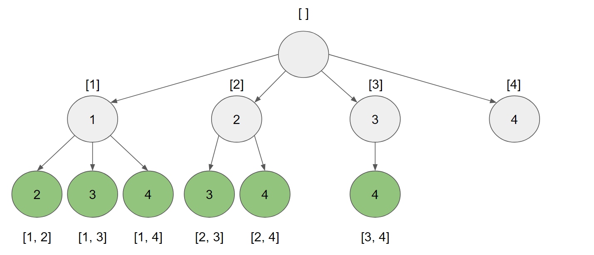

# 77. Combinations

## Condition

Given two integers *n* and *k*, return all possible combinations of *k* numbers out of 1 ... *n*.

**Example:**

```
Input: n = 5, k = 3
Output : 1 2 3 
         1 2 4 
         1 2 5 
         1 3 4 
         1 3 5 
         1 4 5 
         2 3 4 
         2 3 5 
         2 4 5 
         3 4 5
```

## Условие

Даны два целых числа *n* и *k*, вернуть все возможные *combination*'s' из *k* чисел из множества 1 ... *n*.

**Пример:**

```
Input: n = 5, k = 3
Output : 1 2 3 
         1 2 4 
         1 2 5 
         1 3 4 
         1 3 5 
         1 4 5 
         2 3 4 
         2 3 5 
         2 4 5 
         3 4 5
```

[Combination](https://github.com/parshikovpavel/cheat-sheets/blob/master/Algorithm.md#combination)

## Решение 1. Backtracking

**Интуиция**

Нам дано, что `n <= 20`. Как правило, задачи, требующие найти **все** что-либо с нижними границами, можно решить методом *backtracking*.

При использовании метода *backtracking* мы генерируем все решения по одному элементу за раз. В этой задаче от нас требуется сгенерировать все возможные *combination*'s, поэтому мы будем генерировать комбинации по одному элементу за раз.

Диапазон элементов, с которыми мы работаем, равен `[1, n]`. Для генерации *combination* по одному элементу за раз мы будем использовать массив `combination`, представляющий текущую создаваемую комбинацию.

Для начала добавим первый элемент `1`, так что получим `combination = [1]`. Мы фиксируем **это** значение `1`и теперь найдем все *combination*'s, начинающиеся с `1`.

Чтобы найти все комбинации, начинающиеся с `1`, начнем с добавления первого элемента после `1`, то есть `2`. Теперь у нас есть `combination = [1, 2]`. Мы **фиксируем** это значение `2`и теперь будем искать все *combination*'s, начинающиеся с `1, 2`.

Это продолжается до тех пор, пока мы не достигнем целевой длины `k`. Допустим, мы закончили поиск всех *combination*'s, начинающихся с `[1, 2]`. Что дальше? Мы **возвращаемся назад** , удаляя `2`, и снова получаем `combination = [1]`. Теперь мы добавляем второй элемент, который идет после `1`, то есть `3`. Мы получаем `combination = [1, 3]`, и теперь нам нужно найти все *combination*'s, начинающиеся с `[1, 3]`.

Как только мы найдем все *combination*'s, начинающиеся с `[1]`, мы возвращаемся назад, удаляя `1`из `combination`и добавляя следующий элемент. У нас есть `combination = [2]`, и теперь нам нужно найти все *combination*'s, начинающиеся с `2`.

Этот процесс носит рекурсивный характер. Каждый раз, когда мы добавляем элемент, мы решаем новую версию задачи (найти все *combination*'s, начинающиеся с `combination`). Начальная версия задачи состоит в том, чтобы найти все комбинации, начинающиеся с `[]`, что представляет собой все возможные комбинации.

**Деревья**

Наилучший способ представить процесс обратного поиска — смоделировать его в виде дерева. Можно представить пространство решений как дерево, где каждый узел представляет собой вариант `combination`. Присвойте каждому узлу число, представляющее последнее число в `combination`. Переход к дочернему узлу аналогичен добавлению метки дочернего узла к `combination`.

Чтобы предотвратить появление повторяющихся комбинаций, таких как `[1, 2]`и `[2, 1]`, у узла есть дочерние элементы только с метками, превышающими его собственную.

Учитывая `n = 4`и `k = 2`, вот *backtracking tree*:



*Root node* представляет собой пустой массив `[]`. От *root* каждый узел `combination `представляет собой путь, пройденный от *root*. *Node*'s на глубине `k `представляют собой *combination*'s (выделены зеленым цветом).

Решение этой задачи эквивалентно «обходу» этого дерева. Самый простой способ выполнить обход — использовать рекурсию и передать `combination` в качестве аргумента.

Рассматривайте каждый вызов рекурсивной функции как узел в дереве. При каждом вызове нам нужно перебирать числа, большие, чем метка текущего узла. Мы можем передать аргумент, `prev `представляющий первое число, с которого следует начать итерацию.

Для каждого элемента `num `в `[prev, n]` мы добавляем его в, `combination`а затем выполняем рекурсивный вызов, передавая `combination` и `num + 1` в качестве `prev`. Это гарантирует, что мы рассматриваем только числа, большие тех, которые мы уже добавили. Изменение `combination` и выполнение рекурсивного вызова эквивалентно "*traversing"* для *child node* в дереве.

Когда мы возвращаемся из вызова функции, это эквивалентно перемещению вверх по дереву (точно так же, как в алгоритме DFS). При перемещении от *parent* к *child* мы добавляли элемент в `combination`. При перемещении от *child* обратно к его *parent* нам необходимо удалить элемент, который мы добавили из `combination`. Это *"backtracking" step*.

**Этап оптимизации**

Как вы можете заметить на изображении *solution tree* выше, у нас есть путь, который не ведет ни к одному решению (*node* `4`).

Этот путь не ведёт ни к какому решению, потому что после `4` недостаточно элементов, чтобы достичь длины пути, равной `k`. Следует избегать подобных путей, так как они являются пустой тратой времени. Лучше было бы, если бы наше дерево выглядело так:


На каждом узле у нас есть `currentK` элементов. Нам нужно достичь определенного `k` количества элементов. Следовательно, мы можем рассчитать `need = k-currentK `количество элементов, которые нам еще нужно добавить.

Диапазон чисел, рассматриваемых в поддереве, равен `[prev, n]`. Размер этого диапазона равен `remain = n - prev + 1`.

Наконец, мы можем вычислить `available = remain - need`. Это значение представляет собой количество чисел, доступных нам в качестве дочерних элементов. Мы должны рассматривать дочерние элементы только в диапазоне , `[prev, prev + available]` а не в диапазоне , `[prev, n] `как в приведенном выше алгоритме.

Если мы перейдем к дочернему элементу за пределами этого диапазона, например `prev + available + 1`, к , то у нас закончатся числа для использования, прежде чем мы достигнем длины `k`.


Используем рекурсию:

- *base case* – текущий размер *Combination* `currentK` достиг требуемого размера `k`.

- *recursive case*. Перебираем в цикле числа из *set*'а, начиная с позиции `prev` – позиция после числа, взятого на предыдущем шаге рекурсии (в этом случае не возможны повторения *combination*'s). Перебор продолжаем, пока не переберем все числа до `n`, либо не останется в *set* достаточно чисел, чтобы получить Combination размера `k`. 

  Добавляем очередное число `i` в текущую комбинацию `combination`, вызываем функцию рекурсивно, при этом стартовая позиция для очередного перебора  `i + 1`. 

Например для случая, `n = 5` и `k = 3`, исходный *set* – `[1, 2, 3, 4, 5]`.

- Выбираем `1`  и вызываем рекурсивно функцию для добавления чисел, начиная с `2` и т.д. В итоге получаем `{1,2,3}`, `{1,2,4}`, `{1,2,5}`, `{1,3,4}`, `{1,4,5}`.
- Выбираем `2`  и вызываем рекурсивно функцию для добавления чисел, начиная с `3` и т.д. В итоге получаем `{2,3,4}`, `{2,3,5}`, `{2,4,5}`.
- Выбираем `3` и вызываем рекурсивно функцию для добавления чисел, начиная с `4` и т.д. В итоге получаем `{3, 4, 5}`.
- Перебор останавливаем, т.к. *Combination*'s размера `3`, начинающихся с чисел `4` и `5`, – нет. 


[Реализация](solution.go):

```go
func main() {
	const (
		n = 5
		k = 3
	)

	combination := make([]int, k)
	var result [][]int

	recurs(n, k, 0, 0, combination, &result)

	fmt.Println(result)
}

func recurs(n int, k int, currentK int, prev int, combination []int, result *[][]int) {
  // base case – текущий размер Combination `currentK` достиг требуемого размера `k`.
	if currentK == k {
		res := make([]int, k)
		copy(res, combination)
		*result = append(*result, res)
		return
	}

  // количество элементов, которые нам еще нужно добавить
	need := k - currentK
  // осталось всего чисел для перебора
	remain := n - prev
  // имеет смысл еще перебирать столько элементов на данной итерации
	available := remain - need

  // recursive case.
  // Перебираем в цикле числа из set'а, начиная с позиции `prev` – позиция после числа, взятого на 
  // предыдущем шаге рекурсии (в этом случае не возможны повторения *combination*'s).
  // Перебор продолжаем, пока не переберем все числа до `n`, либо не останется в set достаточно чисел,
  // чтобы получить Combination размера `k`.
	for i := prev; i <= prev+available; i++ {
    // Добавляем очередное число `i` в текущую комбинацию `combination`,
		combination[currentK] = i + 1
    // вызываем функцию рекурсивно, при этом стартовая позиция для очередного перебора  `i + 1`. 
		recurs(n, k, currentK+1, i+1, combination, result)
	}
}
```

Количество *k-combination*'s из *n* элементов обозначается *C<sub>n</sub><sup>k</sup>*. ([1](https://github.com/parshikovpavel/cheat-sheets/blob/master/Algorithm.md#combination))

*C<sub>n</sub><sup>k</sup>=(n!) / (k!⋅(n-k)!)*

**Time complexity**: *O(k × C<sub>n</sub><sup>k</sup>)*, т.к. всего *k × C<sub>n</sub><sup>k</sup>*  шагов в дереве поиска (на рисунке видно).

**Space complexity**: *O(k × C<sub>n</sub><sup>k</sup>)*. Т.к. всего есть *C<sub>n</sub><sup>k</sup>* *combination*'s, каждая из которых имеет длину *k*. 

