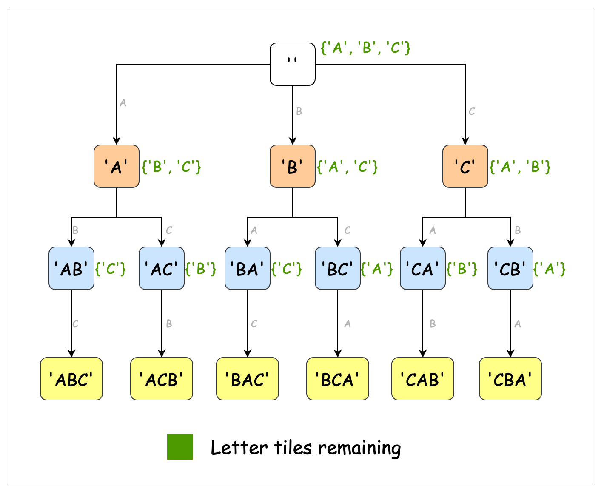

# 1079. Letter Tile Possibilities

## Situation

You have `n` `tiles`, where each tile has one letter `tiles[i]` printed on it.

Return *the number of possible non-empty sequences of letters* you can make using the letters printed on those `tiles`.

 

**Example 1:**

```
Input: tiles = "AAB"
Output: 8
Explanation: The possible sequences are "A", "B", "AA", "AB", "BA", "AAB", "ABA", "BAA".
```

**Example 2:**

```
Input: tiles = "AAABBC"
Output: 188
```

**Example 3:**

```
Input: tiles = "V"
Output: 1
```

 

**Constraints:**

- `1 <= tiles.length <= 7`
- `tiles` consists of uppercase English letters.

## Условие задачи

У тебя есть `n` плиток. На каждой плитке напечатана одна буква — `tiles[i]`.

Верни **количество различных непустых последовательностей букв**, которые можно составить из этих плиток. Каждую плитку можно использовать не более одного раза в одной последовательности.

**Пример 1:**

```
Input: tiles = "AAB"
Output: 8
Explanation: The possible sequences are "A", "B", "AA", "AB", "BA", "AAB", "ABA", "BAA".
```

**Пример 2:**

```
Input: tiles = "AAABBC"
Output: 188
```

**Пример 3:**

```
Input: tiles = "V"
Output: 1
```


**Ограничения:**

- `1 <= tiles.length <= 7`
- `tiles` состоит из заглавных букв английского алфавита.


| #    | Время                                                        | Память                                                       |
| ---- | ------------------------------------------------------------ | ------------------------------------------------------------ |
| 1    | *O(n · n!)* - *n!* раз выполняется рекурсивный вызов, каждый рекурсивный вызов копирует результат за *n* времени (т.к. *n* элементов) | *O(n · n!)* - всего возможно *O(n!)* *sequence*'s, каждая длиной *O(n)* |
| 1.1  | *O(n · n!)* - *n!* раз выполняется перестановка, каждая из них копируется в результат за n времени (т.к. *n* элементов) | *O(n)* - для хранения переменных на стеке рекурсии из *n* вызовов<br/>*O(n!)* для хранения результатов |
|      |                                                              |                                                              |


## Решение 1.  Рекурсия

Давайте подумаем о том, как мы естественным образом составляем различные последовательности из набора букв. Представьте, что у нас есть фишки для игры в Скраббл с буквами "A", "A" и "B". Как бы мы вручную нашли все возможные последовательности? Скорее всего, мы бы начали с отдельных букв ("A", "B"), затем попробовали бы двухбуквенные комбинации ("AA", "AB") и, наконец, трехбуквенные комбинации ("AAB").

В этом ручном процессе важно отметить, что на каждом шаге мы делаем выбор, использовать ли каждую доступную букву. Например, начиная с "AAB", мы сначала решаем: "Следует ли использовать первую букву "A"?". Если мы ее используем, то затем сталкиваемся с аналогичным решением в отношении остальных букв. Если же мы ее не используем, все буквы остаются доступными для выбора в будущем.

Такой подход к принятию решений, при котором каждый выбор сводит проблему к её уменьшенной версии и следует повторяющейся структуре, естественным образом предполагает рекурсивный подход. На каждом уровне рекурсии (или в точке принятия решения) у нас есть два варианта: либо использовать доступную букву и продолжить поиск, либо пропустить её и перейти к следующей букве.

Приведенная ниже диаграмма иллюстрирует структуру дерева рекурсии для данной задачи:



Однако здесь есть один тонкий нюанс, который нам необходимо учесть. Рассмотрим входные данные `"AAB"`еще раз. Если мы не будем внимательны, мы можем подсчитать одну и ту же последовательность несколько раз, потому что у нас есть повторяющиеся буквы. Например, мы можем сформировать последовательность, `"AB"`используя либо первую, либо вторую букву `"A"`.

Для решения этой задачи мы будем хранить все сгенерированные последовательности в хеш-множестве. Хеш-множества позволяют быстро выполнять поиск и обеспечивают уникальность символов благодаря свойству множества, поэтому мы можем проверить, была ли конкретная последовательность уже найдена.

Давайте создадим рекурсивную функцию `recurs`, которая будет создавать все возможные последовательности букв. Мы также будем поддерживать булевый массив `used`размером, равным размеру массива `tiles`. Каждый индекс в массиве `used` указывает , использовался ли символ с этим индексом в `tiles` в текущей последовательности или нет.

Внутри цикла мы добавляем текущую последовательность в хеш-множество. Это необходимо, поскольку все промежуточные последовательности также являются допустимыми комбинациями, а не только те, в которых используются все элементы. Далее мы перебираем каждый символ в `tiles`. Если символ еще не использовался, мы добавляем его в текущую последовательность и выполняем рекурсивный поиск. После исследования этого пути мы возвращаемся назад и помечаем букву как неиспользованную, чтобы иметь возможность попробовать различные комбинации.

Мы начинаем рекурсию, вызывая функцию с пустой строкой `head`. После завершения рекурсии хеш-множество будет содержать все возможные комбинации букв. Наконец, мы возвращаем размер хеш-множества.

[Реализация](solution1.go):

```go
func numTilePossibilities(tiles string) int {
	//для отслеживания уже использованных символов
	used := make([]bool, len(tiles))

	// для хранения уникальных последовательносткй
	result := make(map[string]struct{})

	// запускаем рекурсию, вначале - пустая строка в последовательности
	recurs(tiles, result, used, "")

	return len(result)
}

func recurs(tiles string, result map[string]struct{}, used []bool, head string) {
	// когда получили последовательность с длиной равной количеству символов, 
	// делаем возврат - больше присоединять нечего
	if len(head) == len(tiles) {
		return
	}

	for i := range len(tiles) {
		// если символ использован - пропускаем его
		if used[i] {
			continue
		}
		// присоединяем символ к текущей последовательности
		head += string(tiles[i])
		if _, exist := result[head]; exist {
			// если такая последовательность уже была сохранена ранее
			// убираем символ из последовательности и пропускаем эту ветку
			head = head[:len(head)-1]
			continue
		}

		// если такой последовательности не было - сохраняем ее
		result[head] = struct{}{}
		// помечаем символ - как используемый
		used[i] = true
		// исследуем дальше эту ветку
		recurs(tiles, result, used, head)
		// возвращаем все назад - (1) символ не используется (2) убираем из последовательности
		used[i] = false
		head = head[:len(head)-1]
	}
}

```


## Решение 2: Оптимизированная рекурсия

Представьте, что мы снова играем в Скраббл, но на этот раз у нас есть *sequence* `AAABBC`. Здесь можно сделать важное наблюдение: на самом деле при выборе последующей буквы важно не положение каждой буквы, а количество доступных букв каждого типа. Использование первой или второй буквы `А` не меняет *sequence*'s, которые мы можем создать — нам просто нужно знать, что у нас есть три буквы `А`.

Это открытие приводит нас к первому ключевому решению: вместо отслеживания отдельных букв мы можем отслеживать частоту их встречаемости. Представьте, что у вас есть отдельные стопки для каждой буквы — три плитки в стопке `А`, две в стопке `В` и одна в стопке `С`. Для реализации этого мы можем использовать массив `charCount`, где каждый индекс представляет букву (0 для `А`, 1 для `В` и т. д.), а значение указывает, сколько таких плиток у нас есть.

Теперь давайте подумаем о том, как мы строим *sequence*'s, используя эти частотные подсчеты. На каждом шаге мы задаем себе вопрос: «Какую букву мне следует добавить к моей текущей *sequence*?» Мы можем пройтись по всем 26 буквам и использовать любую букву, которая все еще имеет положительный подсчет. Это принципиально отличается от нашего предыдущего подхода, где мы принимали решения «да/нет» относительно каждой позиции в *sequence* `tiles`.

Поэтапное построение *sequence* с использованием оставшихся букв предполагает рекурсивный подход. Мы передадим `charCount`управление рекурсивной функции и начнем строить *sequence*, удаляя каждый доступный символ по одному. Помните, что нам также необходимо подсчитать все промежуточные *sequence*'s (где `charCount`поле еще не пустое), поскольку они также являются допустимыми *letter tile possibilities*.

Обратите внимание, что в нашем алгоритме мы нигде не работаем с самой *sequence*. Каждая уникальная *sequence* определяется количеством доступных букв `charCount`, а не самой *sequence*. Это означает, что нам больше не нужно поддерживать *hashtable* для хранения посещенных *sequence*'s, что значительно экономит место.

Наша основная функция вызывает рекурсивный метод со всем `charCount`массивом. Возвращаемый им результат — это и есть требуемый ответ.

[Реализация](solution2.go):

```go
func numTilePossibilities(tiles string) int {
	// Заводим array под подсчет количества символов, один элемент - под каждый символ (из 26)
	var charCount [26]int
	// счетчик количества sequence's
	var totalCount int

	// Считаем количества каждого символа в строке
	for _, c := range tiles {
		charCount[c-'A']++
	}

	// Запускаем рекурсию
	findSequences(charCount, &totalCount)

	return totalCount
}

func findSequences(charCount [26]int, totalCount *int) {
	// идем последовательно по каждому символу
	for pos := range len(charCount) {
		// если есть такой доступный для подстановки символ
		if charCount[pos] == 0 {
			continue
		}

		// то считаем, что его добавили и уменьшаем счетчик
		charCount[pos]--
		// получили еще одну sequence, увеличиваем счетчик
		*totalCount++

		findSequences(charCount, totalCount)

		// возвращаем символ назад в массив счетчиков
		charCount[pos]++
	}
}
```


## Решение 3: Permutation's и Combination's
